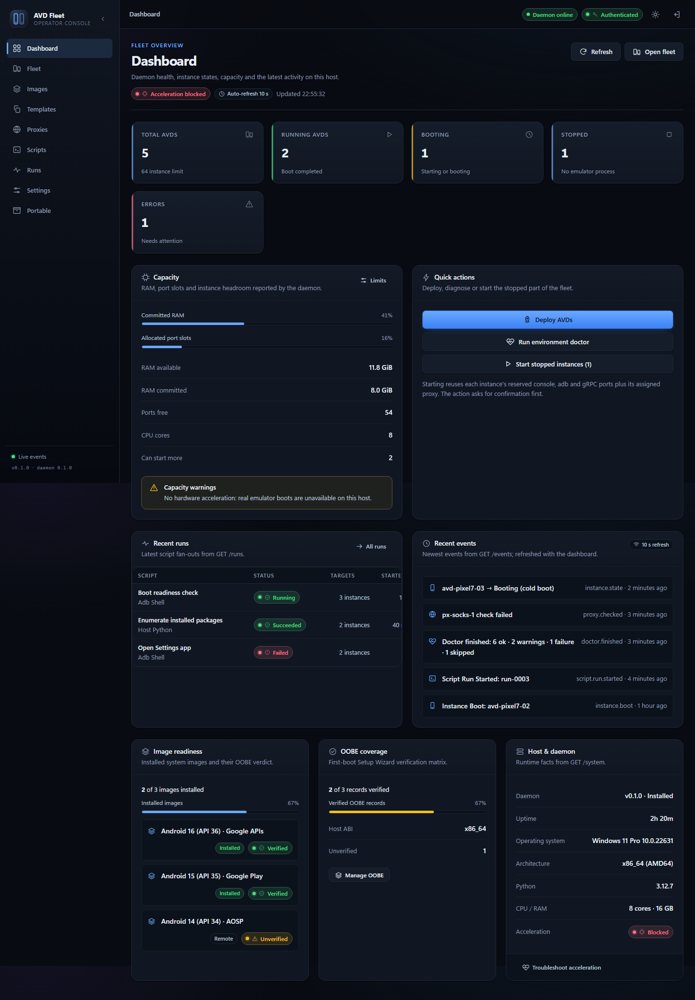
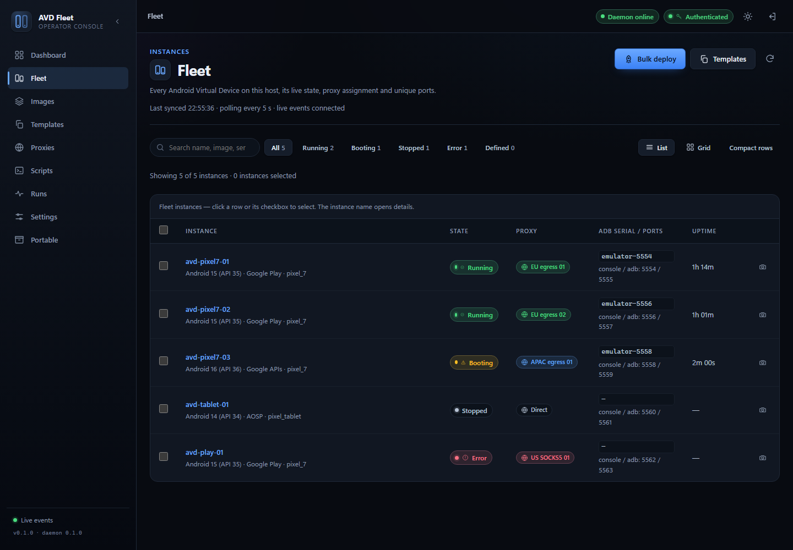
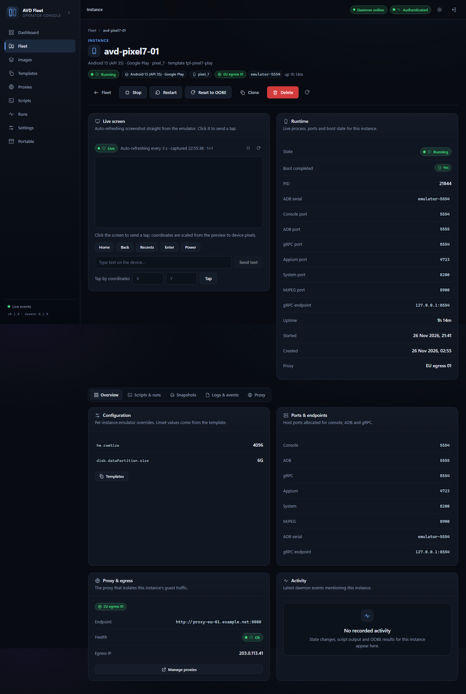
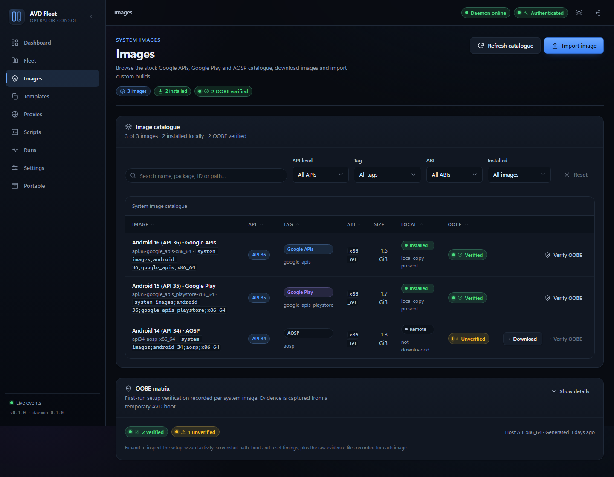
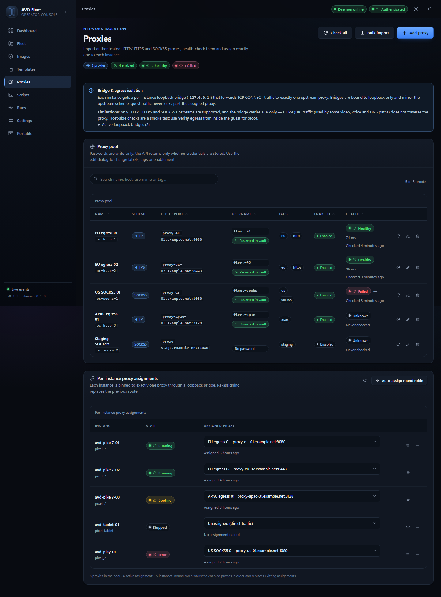
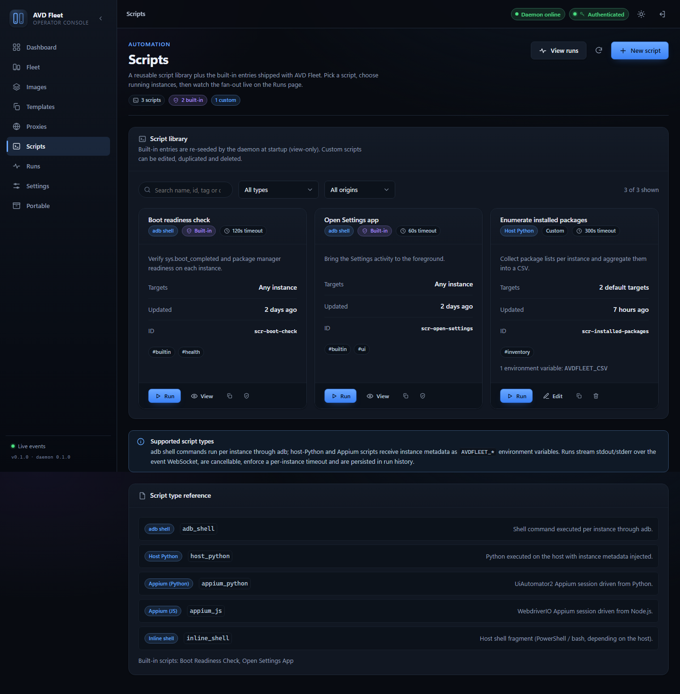
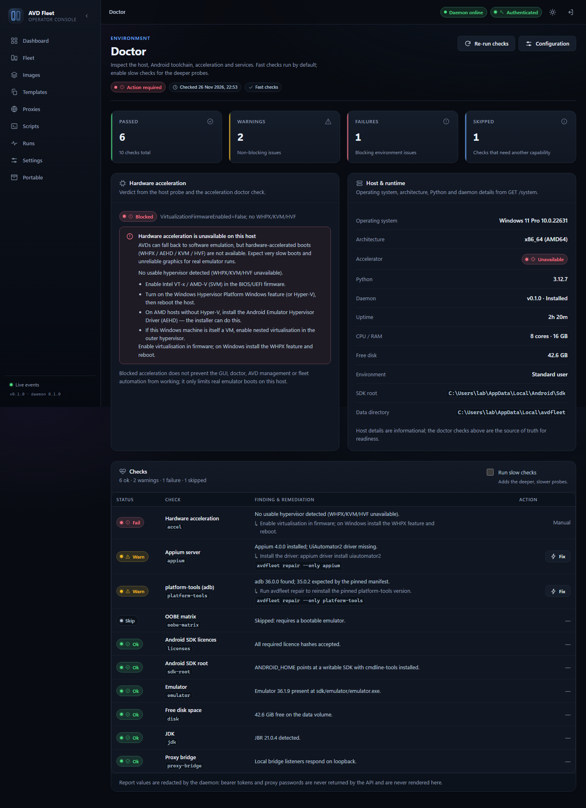
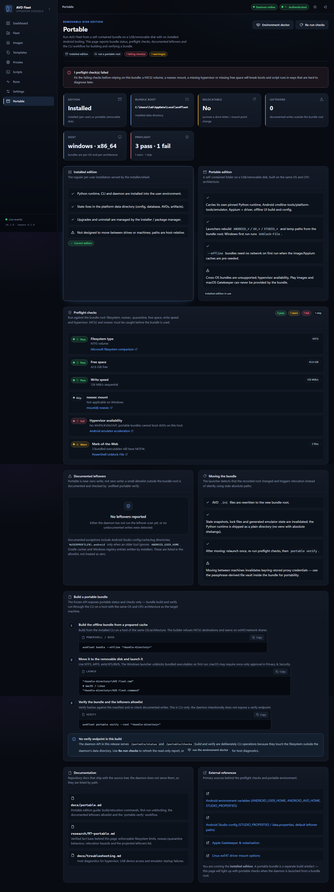

# AVD Fleet

**Install, isolate and automate fleets of Android Virtual Devices — from a GUI, a CLI or an API.**

Repository: <https://github.com/willokocha-spec/AVD-Fleet-Manager>

[](https://github.com/willokocha-spec/AVD-Fleet-Manager/actions/workflows/ci.yml)

AVD Fleet (`avdfleet`) turns a powerful workstation into a repeatable Android device lab:

- one-command installer for the Android SDK, emulator, JDK, Node, Appium 4 and scrcpy
- catalogue, download and custom-import system images (Google APIs, Play Store, AOSP)
- deploy and supervise up to **64 AVDs**, each with an isolated authenticated proxy
- verify the Out-of-Box-Experience (OOBE) state and reset any AVD to it
- run adb-shell, host-Python and Appium scripts across the whole fleet in parallel
- a **portable edition** that runs offline from a USB stick without admin rights

> Out of scope by design: rooting or modifying Play Store images, bypassing
> Play Integrity/SafetyNet, device fingerprint spoofing and automated Google account
> creation. AVD Fleet only uses stock or user-supplied images.

## Project status (read this first)

The engine, API, CLI, GUI and portable bundler are implemented and covered by
fakes-backed unit, contract, API, integration, portable, CLI and UI tests. A
first real-emulator acceptance pass has been produced on a WHPX host (Windows
11): real AVDs boot and OOBE, script fan-out and the fleet dry run were
exercised against them - see
[docs/live-acceptance-2026-11-27.md](docs/live-acceptance-2026-11-27.md). The
original build host had no usable hypervisor, so the proxy gate (G1), real
Appium sessions and custom-image boot are still **unverified**, not passed. The
item-by-item truth is in [docs/acceptance.md](docs/acceptance.md); the final
build report is in [FINAL_REPORT.md](FINAL_REPORT.md). Re-run
`avdfleet selftest --e2e` on an accelerated host to reproduce.

## Quick start (installed edition)

Prerequisites and per-OS details: [Windows](docs/quickstart-windows.md) ·
[macOS](docs/quickstart-macos.md) · [Linux](docs/quickstart-linux.md).

```bash
# macOS / Linux
chmod +x bootstrap/install.sh
./bootstrap/install.sh --accept-android-sdk-licenses --yes
```

```powershell
# Windows (PowerShell; elevated recommended)
powershell -ExecutionPolicy Bypass -File .\bootstrap\install.ps1 -AcceptAndroidSdkLicenses -Yes
```

Windows may reboot once (WHPX); re-run the same command afterwards and the
installer resumes. A second run is a no-op. Then:

```bash
avdfleet doctor
avdfleet serve            # GUI at http://127.0.0.1:8765/
avdfleet gui              # start the daemon if needed and sign the browser in automatically
avdfleet selftest --e2e   # full OOBE + proxy + scripts self-test on a real host
```

## Quick start (portable edition)

```bash
avdfleet bundle --offline -o AVD-Fleet-Portable
# copy the folder to a fresh machine with virtualization enabled
# Windows: double-click "AVD Fleet.cmd"
# macOS:   open "AVD Fleet.command"
# Linux:   ./avdfleet.sh
```

See [docs/portable.md](docs/portable.md) for the prepared-cache build model,
relocation, preflight checks and the documented leftovers.

## Documentation

| Topic | Document |
|---|---|
| Windows 11 quick start | [docs/quickstart-windows.md](docs/quickstart-windows.md) |
| macOS Apple Silicon quick start | [docs/quickstart-macos.md](docs/quickstart-macos.md) |
| Linux quick start (Ubuntu/Debian, Fedora, Rocky/RHEL, Arch) | [docs/quickstart-linux.md](docs/quickstart-linux.md) |
| Installer engine, steps, manifest, reboot/resume | [docs/installer.md](docs/installer.md) |
| Portable edition (build, launch, relocate, leftovers) | [docs/portable.md](docs/portable.md) |
| Proxy isolation, bridge, DNS/UDP limitations, G1 | [docs/proxy.md](docs/proxy.md) |
| OOBE matrix, detection, reset strategies | [docs/oobe.md](docs/oobe.md) |
| Scripts, fan-out, Appium, screen/gRPC | [docs/scripting.md](docs/scripting.md) |
| `fleet.yaml` reference and reconciliation | [docs/fleetspec.md](docs/fleetspec.md) |
| REST/WebSocket API | [docs/api.md](docs/api.md) |
| CLI reference | [docs/cli.md](docs/cli.md) |
| Host/version compatibility matrix | [docs/compatibility.md](docs/compatibility.md) |
| Testing and contributing | [docs/testing.md](docs/testing.md) |
| Troubleshooting matrix | [docs/troubleshooting.md](docs/troubleshooting.md) |
| Acceptance evidence (honest status) | [docs/acceptance.md](docs/acceptance.md) |
| Live acceptance on an accelerated host (2026-11-27) | [docs/live-acceptance-2026-11-27.md](docs/live-acceptance-2026-11-27.md) |
| Architecture | [docs/architecture.md](docs/architecture.md) |
| Security model | [docs/security.md](docs/security.md) |
| Bootstrap scripts | [bootstrap/README.md](bootstrap/README.md) |
| GUI development | [ui/README.md](ui/README.md) |
| Supplied prompt, part 1 (sections 0–3.1) | [BRIEF_ORIGINAL.md](BRIEF_ORIGINAL.md) |
| Decisions and deviations | [DECISIONS.md](DECISIONS.md) |
| Agent/wave ledger | [PLAN.md](PLAN.md) |

## Screenshots

The GUI was captured with Playwright + Microsoft Edge against the Vite dev server with
MSW mock data, so the images are labelled **mock data** and are not real-emulator
evidence. All 12 pages are in [docs/screenshots/](docs/screenshots/).

| | |
|---|---|
| [](docs/screenshots/dashboard.png) | [](docs/screenshots/fleet.png) |
| [](docs/screenshots/instance-detail.png) | [](docs/screenshots/images.png) |
| [](docs/screenshots/proxies.png) | [](docs/screenshots/scripts.png) |
| [](docs/screenshots/doctor.png) | [](docs/screenshots/portable.png) |

The remaining pages are [deploy.png](docs/screenshots/deploy.png),
[templates.png](docs/screenshots/templates.png), [runs.png](docs/screenshots/runs.png)
and [settings.png](docs/screenshots/settings.png).

## Editions

- **Installed** — `uv tool install avdfleet` plus a one-command bootstrap; one
  Python package, one loopback daemon serving REST, WebSockets and the built
  React GUI; state under the platform data directory.
- **Portable** — a self-contained per-host folder (relocatable Python runtime,
  SDK tools, Appium, UI, state) built from a prepared cache, with launchers,
  checksum manifest, preflight checks and relocation support. Windows/macOS/Linux
  x64|arm64 as supported by the emulator; no admin rights; no writes outside the
  root except the documented leftovers.

## Development

```bash
python -m pip install -e ".[dev]"
pytest                       # no Android tools required: uses executable fakes
ruff check src tests bootstrap
mypy
python -m pytest bootstrap/test_bootstrap.py -q

cd ui
pnpm install
pnpm typecheck && pnpm lint && pnpm test && pnpm build
```

The test suite runs against process-boundary fakes (`tests/fakes`) so it needs
no emulator. Tests marked `emulator` require WHPX, KVM or HVF and are skipped
automatically. See [docs/testing.md](docs/testing.md) for layers, markers and CI.

## Repository layout

```
bootstrap/      thin install.sh / install.ps1 + their static tests
contracts/      frozen OpenAPI 3.1, event/fleet/bundle JSON schemas, fakes spec
src/avdfleet/   core, platform, proxy, oobe, scripts, appium, screen,
                portable, store, api, cli, fleetspec
ui/             React + TypeScript GUI (Vite, MSW, Vitest)
tests/          fakes, unit, api, contract, integration, portable, cli
docs/           user and operator documentation
research/       version/host/networking/OOBE/image/portable research + G1 protocol
.github/        CI, nightly best-effort emulator, release workflows
```

## Security

Loopback-only daemon with a bearer token (0600 token file), encrypted proxy
vault (OS keyring or passphrase file vault), constant-time auth, WS token +
Origin checks, and a single redaction choke point for logs/errors/run records.
Read [docs/security.md](docs/security.md) and the proxy limitations in
[docs/proxy.md](docs/proxy.md). Report issues privately; never include real
credentials or SDK licence files.

## License

MIT — see [LICENSE](LICENSE). This project is not affiliated with Google or Android.
Android SDK components and Google system images are subject to Google's licences and are
not redistributed by this project.

## Publishing

See [PUBLISHING.md](PUBLISHING.md) for the GitHub prerequisites, commands, release-asset
layout and pre-publish checklist. Prebuilt portable bundles and a GitHub-ready source
archive are under `dist/` (`AVD-Fleet-Portable-Windows-*.zip`,
`avdfleet-0.1.0-source.zip`, `SHA256SUMS.txt`).
